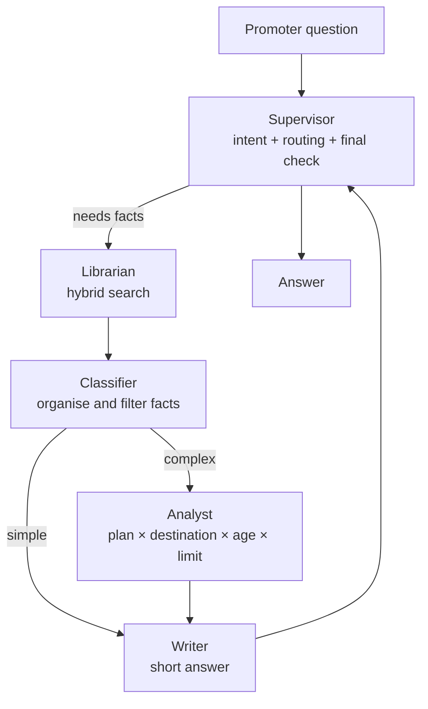

# Travel Insurance Multi-agent RAG

Five specialised agents, coordinated by a supervisor, answer partner sales teams' questions about travel and dental cover straight from the product book, using hybrid search.

**Stack:** Python · LangGraph · Azure OpenAI · Azure AI Search (vector + keyword) · Azure Document Intelligence · Streamlit
**Role:** Lead developer: design and implementation
**Status:** Prototype

> Built at a large Brazilian insurer. The company is replaced by the fictional **Acme Seguros**, and every name, document and data point here is fictional. Code, prompts and UI are in Portuguese, written for Brazilian business teams.

## Problem

Partner promoters (travel agencies, retailers) had frequent, repetitive questions such as "Does the basic plan cover adventure sports?" The answers were in a long product book, but finding them meant calling the insurer's commercial team, which became a bottleneck. Answers have to be short (the promoter is in front of a customer) and must never invent cover.

## What I built



- **Supervisor** routes to whichever agent is needed next and validates the final answer.
- **Hybrid search** (vector plus keyword): product books are full of exact plan names and limits that pure embeddings blur.
- **Analyst** only runs for multi-step questions, so simple look-ups stay fast and cheap.
- **Indexing ahead of time** with a separate script; the chat only searches.

Full write-up with trade-offs: [docs/CASE_STUDY.md](docs/CASE_STUDY.md)

## Run it

```bash
python -m venv .venv && .venv\Scripts\activate   # macOS/Linux: source .venv/bin/activate
pip install -r requirements.txt
cp .env.example .env                               # Azure OpenAI + AI Search
streamlit run agent.py
```

Needs an Azure AI Search index built from your own product book.

---
Part of my [AI engineering portfolio](https://github.com/lucasboliveirasipp).
