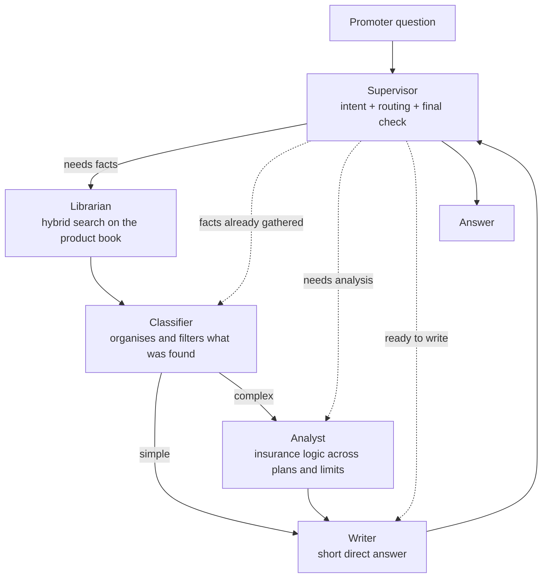

# Multi-agent Travel Insurance Assistant — case study

A LangGraph multi-agent assistant that answers coverage questions about travel and dental insurance for the sales teams of business partners, using the product book as its only source.

> Built at a large Brazilian insurer. Names, documents and data are fictional.

## Context

Partners (travel agencies, retailers) sell the insurer's travel and dental products through their own sales promoters. Promoters had frequent, repetitive questions ("Does the basic plan cover adventure sports?", "What is the medical expense limit in Europe?"). The answers were all in a long product book, but finding them meant calling the insurer's commercial team, which became a bottleneck.

## The problem

- Answers must be short and direct: the promoter is usually in front of a customer.
- Some questions are simple look-ups; others need reasoning across plans, destinations and age limits.
- The assistant must never invent coverage. If the book doesn't say it, it says so.

## What I built

Five specialised agents coordinated by a supervisor:



- **Supervisor:** identifies intent, sends the question to whichever agent is needed next, and validates the final answer before returning it.
- **Librarian:** retrieves passages from the product book indexed in Azure AI Search (vector and keyword together), with caching.
- **Classifier:** groups and filters the retrieved facts and decides whether the question needs analysis.
- **Analyst:** handles multi-step questions (plan × destination × age × limit).
- **Writer:** produces a concise answer in the promoter's language.

Documents are indexed **ahead of time** by a separate script (PDF extraction with Document Intelligence, chunking, embeddings), so the chat only searches and never indexes at run time.

## Key decisions and trade-offs

| Decision | Why | Trade-off |
|---|---|---|
| **Supervisor validates the writer's answer** before it reaches the user | Catches answers not supported by the retrieved passages | One extra LLM call per question |
| **Split simple and complex paths** after classification | Most questions are look-ups and should be fast and cheap | Misclassified questions get a shallower answer |
| **Hybrid search** (vector + keyword) instead of vector only | Product books are full of exact terms (plan names, amounts, countries) that pure embeddings blur | A larger index and more tuning |
| **Offline indexing** | Predictable latency in the chat and no indexing cost per question | The book must be re-indexed when it changes |
| **Cache** for searches, embeddings and extraction, each with its own TTL | Repeated questions are common | Stale answers are possible until the TTL expires |

## Illustrative snippet

```python
graph = StateGraph(AssistantState)
for name, node in [("supervisor", supervisor), ("librarian", librarian),
                   ("classifier", classifier), ("analyst", analyst), ("writer", writer)]:
    graph.add_node(name, node)

graph.set_entry_point("supervisor")
graph.add_conditional_edges("supervisor", route_after_supervisor,
                            {n: n for n in ("librarian", "classifier", "analyst", "writer")} | {END: END})
graph.add_edge("librarian", "classifier")
graph.add_conditional_edges("classifier", lambda s: "analyst" if s["complex"] else "writer")
graph.add_edge("analyst", "writer")
graph.add_edge("writer", "supervisor")
```

## Stack

Python · LangGraph · LangChain · Azure OpenAI · Azure AI Search (hybrid) · Azure Document Intelligence · Pydantic · diskcache · Streamlit
